<div align="center">

  <!-- Stylized Cyberpunk Title Header -->
  


  <!-- Dynamic Live Typing Terminal -->
  <a href="https://git.io/typing-svg">
    
  </a>

  <br/><br/>

  <a href="https://dev-vasu.github.io/digital-id/">
    
  </a>

  <br/><br/>

  <!-- High-Precision HUD Quick-Action Dock -->
  <a href="https://dev-vasu.github.io/digital-id/" target="_blank">
    
  </a>
  &nbsp;
  <a href="https://linkedin.com/in/vasudev-singh-jamwal" target="_blank">
    
  </a>
  &nbsp;
  <a href="https://x.com/vasudevsinghh" target="_blank">
    
  </a>
  &nbsp;
  <a href="https://www.instagram.com/rajput.vasudevv/" target="_blank">
    
  </a>
  &nbsp;
  

</div>

<br/>

---

### 🛰️ `SYSTEM_TELEMETRY::OVERVIEW`

```shell
┌──[vasudev@quantum-core]─[~]
└──$ neofetch --ascii_distro arch --stdout
       /\         OPERATOR: Vasudev Singh Jamwal
      /  \        ROLE: Software Support Engineer @ GreyOrange
     /\   \       SPECIALIZATION: Robotics Systems & Distributed Automation
    /      \      INFRASTRUCTURE: Kubernetes Cluster, Docker, Linux VMs, Erlang BEAM
   /   ,,   \     STORAGE & METRICS: PostgreSQL, InfluxDB, Grafana Telemetry
  /   |  |  -\    INTERFACES: RESTful APIs, Swagger Specs, Postman, cURL
 /_-''    ''-_\   COGNITIVE ENGINE: Generative AI, LLMs, Neural Sequence Models
                  LOCATION: Gurugram, Haryana, India 🇮🇳
                  SYSTEM STATUS: 🟢 OPTIMAL (Production Operations)
                  DIGITAL IDENTITY: https://dev-vasu.github.io/digital-id/
```

---

### 🧬 `NEURAL_ARSENAL & PRODUCTION_MATRIX`

<div align="center">
  <table>
    <thead>
      <tr style="background: rgba(6, 182, 212, 0.1);">
        <th align="center" width="160">SUBSYSTEM</th>
        <th align="left">ACTIVE TECHNOLOGIES & TOOLCHAINS</th>
      </tr>
    </thead>
    <tbody>
      <tr>
        <td align="center"><b>☁️ Cloud & Orchestration</b></td>
        <td>
          
        </td>
      </tr>
      <tr>
        <td align="center"><b>📊 Observability & DBs</b></td>
        <td>
          
          <a href="#"></a>
        </td>
      </tr>
      <tr>
        <td align="center"><b>⚡ Runtime & Scripting</b></td>
        <td>
          
        </td>
      </tr>
      <tr>
        <td align="center"><b>🔌 API Architecture</b></td>
        <td>
          
          <a href="#"></a>
          <a href="#"></a>
        </td>
      </tr>
      <tr>
        <td align="center"><b>🧠 AI / ML & GenAI</b></td>
        <td>
          
          <a href="#"></a>
        </td>
      </tr>
    </tbody>
  </table>
</div>

---

### 🏆 `DEVELOPER_ACHIEVEMENTS & TROPHIES`

<div align="center">
  
</div>

---

### ⚡ `ENGINEERED_SYSTEMS & RESEARCH_PROJECTS`

<div align="center">
  <a href="https://dev-vasu.github.io/digital-id/" target="_blank">
    
  </a>
  <a href="https://github.com/dev-vasu/Traffic-Incident-Classifier" target="_blank">
    
  </a>
</div>

<div align="center">
  <a href="https://github.com/dev-vasu/Music-recommendation-System-with-Collaborative-Filtering" target="_blank">
    
  </a>
  <a href="https://github.com/dev-vasu/Habito" target="_blank">
    
  </a>
</div>

<br/>

<div align="center">
  <table>
    <thead>
      <tr style="background: rgba(148, 163, 184, 0.08);">
        <th align="left">SYSTEM / REPOSITORY</th>
        <th align="left">DOMAIN ARCHITECTURE</th>
        <th align="left">KEY TOOLCHAINS</th>
        <th align="center">ACCESS</th>
      </tr>
    </thead>
    <tbody>
      <tr>
        <td><b>🪪 Cyber Digital ID Hub</b></td>
        <td>WebGL 3D Physics Canvas &amp; Custom Kinetic FakeScroll Driver</td>
        <td><code>HTML5</code> <code>CSS Grid</code> <code>WebGL</code> <code>vCard 3.0</code></td>
        <td align="center"><a href="https://dev-vasu.github.io/digital-id/"><b>[ 🌐 LIVE NODE ]</b></a></td>
      </tr>
      <tr>
        <td><b>🤖 Neural Autocorrection</b></td>
        <td>Bi-directional Sequence Modeling &amp; Embedding Proximity</td>
        <td><code>Python</code> <code>Deep Learning</code> <code>NLP</code> <code>Vectors</code></td>
        <td align="center"><a href="https://github.com/dev-vasu"><b>[ 📦 REPO ]</b></a></td>
      </tr>
      <tr>
        <td><b>🎵 Collaborative Recommender</b></td>
        <td>Matrix Factorization &amp; Latent Representation Algorithms</td>
        <td><code>Python</code> <code>NumPy</code> <code>Pandas</code> <code>Scikit-Learn</code></td>
        <td align="center"><a href="https://github.com/dev-vasu/Music-recommendation-System-with-Collaborative-Filtering"><b>[ 📦 REPO ]</b></a></td>
      </tr>
      <tr>
        <td><b>🚦 Traffic Incident Classifier</b></td>
        <td>Deep Convolutional Vision Classifier for Road Anomaly Detection</td>
        <td><code>PyTorch</code> <code>CNN</code> <code>OpenCV</code> <code>Computer Vision</code></td>
        <td align="center"><a href="https://github.com/dev-vasu/Traffic-Incident-Classifier"><b>[ 📦 REPO ]</b></a></td>
      </tr>
      <tr>
        <td><b>📱 Habito Tracking System</b></td>
        <td>Reactive Mobile Architecture with Persistent Local Engine</td>
        <td><code>Flutter</code> <code>Dart</code> <code>State Management</code> <code>SQLite</code></td>
        <td align="center"><a href="https://github.com/dev-vasu/Habito"><b>[ 📦 REPO ]</b></a></td>
      </tr>
    </tbody>
  </table>
</div>

---


### 📊 `QUANTUM_METRICS & GITHUB_ACTIVITY`

<div align="center">
  <a href="https://github.com/dev-vasu">
    
  </a>
  <a href="https://github.com/dev-vasu">
    
  </a>
</div>

<div align="center">
  <a href="https://github.com/dev-vasu">
    
  </a>
  <a href="https://github.com/dev-vasu">
    
  </a>
</div>

<br/>

<div align="center">
  
</div>

---

### 📬 `ESTABLISH_ENCRYPTED_UPLINK`

<div align="center">
  <a href="https://dev-vasu.github.io/digital-id/" target="_blank">
    
  </a>
</div>

<div align="center">
  <a href="https://www.linkedin.com/in/vasudev-singh-jamwal" target="_blank">
    
  </a>
  <a href="mailto:svasudev941@gmail.com">
    
  </a>
</div>

<div align="center">
  <a href="https://x.com/vasudevsinghh" target="_blank">
    
  </a>
  <a href="https://www.instagram.com/rajput.vasudevv/" target="_blank">
    
  </a>
</div>
